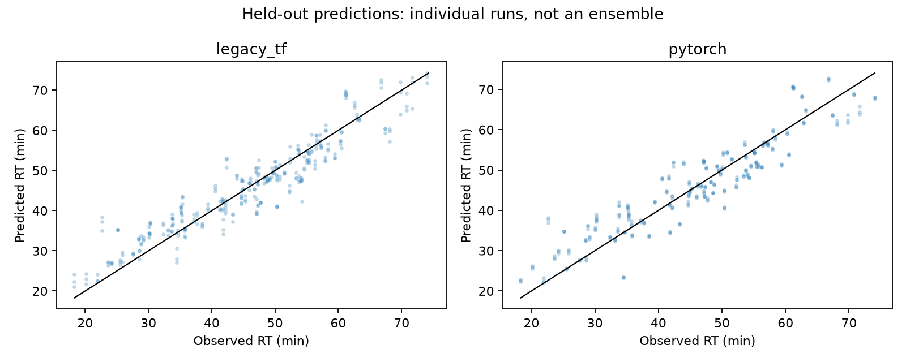
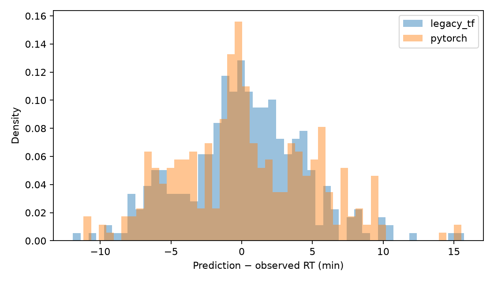

# full_fa_cross_modified: TensorFlow reference and PyTorch

Predictions were regenerated from the validation-selected checkpoints. Train, validation and test rows retain the original grouped split; only test metrics describe held-out accuracy. Errors are in seconds.

```text
           rmse_mean  rmse_seed_sd  mae_mean  r2_mean
model                                                
legacy_tf    256.162         2.803   196.512    0.886
pytorch      288.706         4.537   227.190    0.855
```






Error bars are seed standard deviations, not confidence intervals. TensorFlow is retired from the maintained package. Its checkpoint format, source and original environment locks are retained only as archival evidence.
