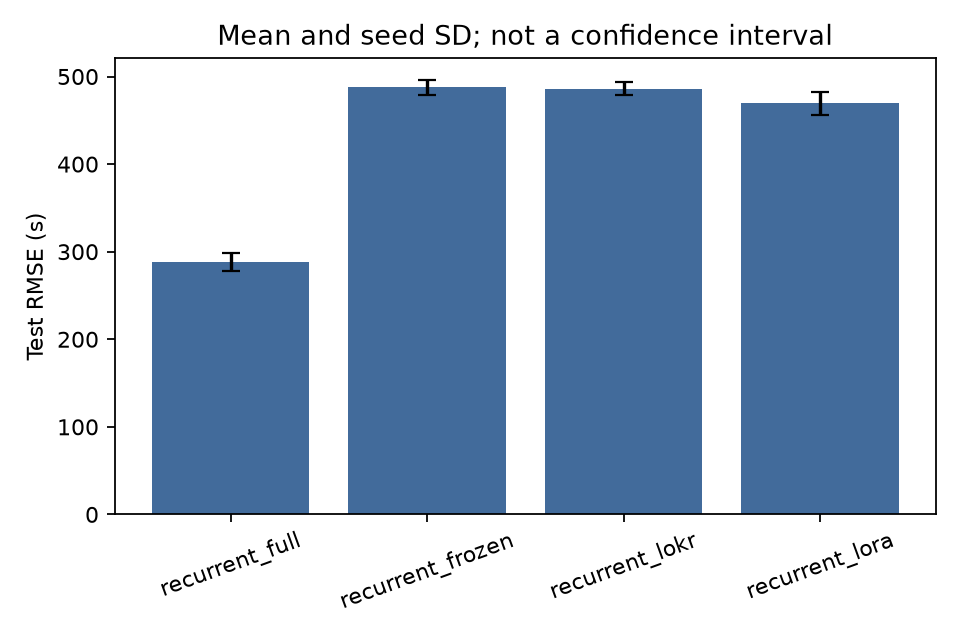
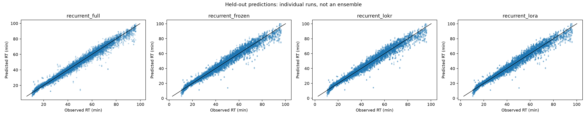

# Native recurrent fine-tuning

This experiment compares four production PyTorch strategies from the same
train-only starting checkpoint for each cohort and seed. It is separate from
the historical TF/PyTorch validation sweep.

## Held-out accuracy

Test RMSE across **60 fitted models**, in **seconds** (mean ±
initialization-seed standard deviation). Lower is better.

| Cohort | Full model | Frozen encoder | GRU-LoKr | GRU-LoRA |
|---|---:|---:|---:|---:|
| E. coli crosslinks | **258.4 ± 1.2** | 291.2 ± 11.7 | 290.0 ± 10.7 | 288.3 ± 11.2 |
| E. coli pLink crosslinks | **322.4 ± 1.6** | 343.4 ± 1.4 | 341.8 ± 1.5 | 340.6 ± 2.3 |
| FA crosslinks | **287.9 ± 10.3** | 487.7 ± 8.5 | 486.1 ± 7.1 | 469.5 ± 13.0 |
| FA linear peptides | **599.3 ± 24.5** | 645.9 ± 5.5 | 644.6 ± 5.0 | 649.7 ± 1.9 |
| E. coli linear peptides | **183.9 ± 28.8** | 236.6 ± 1.6 | 235.5 ± 1.4 | 234.5 ± 1.3 |

Full fine-tuning has the lowest mean RMSE on every cohort in this fixed
configuration. LoKr differs from frozen-encoder head training by less than
0.5% on all five. LoRA makes modest gains over frozen training on four cohorts,
including 3.7% on FA crosslinks, but is slightly worse on FA linear peptides.
Neither adapter strategy matches full fine-tuning here.
This does not establish an improvement over the separately tuned native
baseline: its training budget and validation-selection protocol differ.



FA crosslinks show the clearest separation: full fine-tuning reduces RMSE
by approximately 41% relative to frozen training. The adapters leave most of
that deficit unresolved at the tested rank and learning-rate ratio.



E. coli linear peptides retain substantial full-fine-tuning seed variability.
The tighter dispersion of frozen/adapted runs comes with higher mean error,
not improved accuracy.

## Parameters and measured training time

The benchmark uses compact recurrent networks. Frozen heads train **289**
parameters; LoKr trains **441** and LoRA **769**. Full training updates
**1,729–1,833**, depending on cohort vocabulary size. These counts describe
this architecture, not a large pretrained protein model.

| Cohort | Full (s) | Frozen (s) | LoKr (s) | LoRA (s) |
|---|---:|---:|---:|---:|
| E. coli crosslinks | 53.1 | 10.9 | 36.2 | 31.5 |
| E. coli pLink crosslinks | 48.4 | 10.8 | 32.0 | 31.0 |
| FA crosslinks | 5.7 | 1.2 | 4.7 | 5.8 |
| FA linear peptides | 9.7 | 2.1 | 5.9 | 6.8 |
| E. coli linear peptides | 106.8 | 23.6 | 57.8 | 76.6 |

Times are means of the recorded fitting calls, excluding starting-checkpoint
pretraining, data preparation and exports. Early stopping can change executed
epoch counts. Shared-host contention and implementation overhead mean that
parameter ratios do not predict elapsed-time ratios.

## Protocol

| Setting | Value |
|---|---|
| Cohorts | E. coli crosslinks, pLink crosslinks, FA crosslinks, FA linear peptides, E. coli linear peptides |
| Seeds | 17, 29, 43 |
| Strategies | Full model, frozen encoder, GRU-LoKr, GRU-LoRA |
| Budget | At most 30 additional epochs per run |
| Optimizer | AdamW; base learning rate 0.003, weight decay 0.01 |
| Batch size | 64 |
| Adapters | Rank 4, alpha 4; LoKr factor 4 |
| Adapter learning rate | 0.1 × base learning rate |
| Scheduler | Validation plateau; factor 0.5, patience 3 |
| Early stopping | Validation loss, patience 8 |
| Device | CPU, two PyTorch threads |

The starting checkpoints were trained only on the outer training partition.
All four strategies retain the same architecture, vocabulary, grouped splits
and training-only target normalization. Full training updates all model
parameters; frozen training updates the prediction heads; LoKr/LoRA update GRU
gate adapters and heads while preserving the base encoder parameters.

Validation loss selects the best epoch. The checkpoint is then saved,
reconstructed and scored on the held-out test rows. The pipeline checks that
frozen weights and encoder normalization buffers have not changed.

## Retained outputs

`benchmark-tf-torch/fine-tune-torch/` contains the resolved protocol, environment,
frozen source, per-run checkpoints, histories, predictions and quality records.
`results/metrics.csv` contains train/validation/test scores;
`results/test-summary.csv` summarizes held-out errors across seeds;
`results/plots/<cohort>/` contains prediction, residual and RMSE figures.

The SHA256 index covers each published artifact. Verification recomputes
per-run metrics and the aggregate tables:

```bash
bash run.sh verify
```

To rerun on the current environment without overwriting measured output:

```bash
bash run.sh fine-tune --output benchmarks/results/fine-tune-local
```

The original measurement used Python 3.12.3 and PyTorch 2.14.1 on CPU; exact
package versions and source hashes are recorded in `protocol.json` and
`environment.json`. The current development interpreter may differ. A changed
source, environment or configuration requires a distinct output directory.
The frozen protocol identity is
`2eae9f1a7aefab5c8b66459b801abb88828ac75a18517a0617db110d8c0305e6`.
The archived source is the implementation used for these measurements, not
a copy of the current application. Activity and kernel penalties are zero in
this protocol. Use the saved source and environment for exact reproduction;
use the current package for new experiments.

## Interpretation

This is **staged within-cohort training**, not external transfer learning.
The base and adaptation stages use the same outer training set, never the
held-out pairs. Three seeds share one partition and the cohorts are correlated
views of two studies. Initialization-seed standard deviation is not a
confidence interval.

The learning rate, rank and adapter-rate ratio were fixed, not separately
tuned for each strategy. Results therefore describe this operating point,
not the best achievable LoRA, LoKr or full-fine-tuning performance. Parameter
savings are useful engineering properties but do not establish accuracy or
runtime superiority.

See [the fine-tuning API and YAML](../fine-tuning.md) for production usage.
