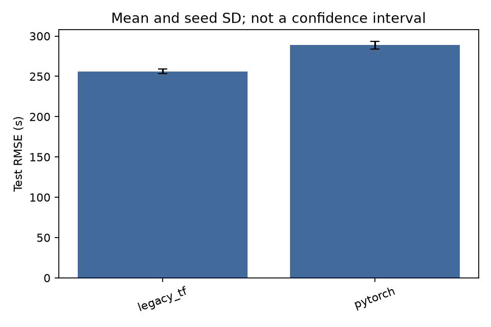

# TensorFlow versus native PyTorch

This comparison covers five modification-aware RP cohorts and seeds 17, 29
and 43. PyTorch is the maintained backend; TensorFlow predictions are retained
as a reference. The reference uses the historical
TensorFlow architecture with **AdamW**, not the original publication's complete
training procedure.

## Held-out accuracy

Mean ± initialization-seed standard deviation; RT errors are **seconds**.
Lower RMSE is better. These are individual fitted models, not ensembles.

| Cohort | TensorFlow RMSE | PyTorch RMSE | TF MAE | PyTorch MAE |
|---|---:|---:|---:|---:|
| E. coli crosslinks | 256.4 ± 2.0 | **253.9 ± 2.6** | 169.6 | 166.3 |
| E. coli pLink crosslinks | 337.0 ± 11.3 | **321.7 ± 3.5** | 218.7 | 204.1 |
| FA crosslinks | **256.2 ± 2.8** | 288.7 ± 4.5 | 196.5 | 227.2 |
| FA linear peptides | **613.1 ± 42.7** | 630.0 ± 25.4 | 462.5 | 469.2 |
| E. coli linear peptides | **160.8 ± 3.2** | 187.1 ± 34.5 | 109.5 | 131.8 |

PyTorch has lower mean RMSE on two cohorts. The E. coli crosslink difference
is small; the larger PyTorch deficits are FA crosslinks (+12.7%) and E. coli
linear peptides (+16.4%). The latter also shows substantially greater seed
variation. Framework replacement alone is not evidence of accuracy parity.

Both models predict the broad RT range, but the diagonal scatter should not
be interpreted as independent replicates: the three seeds predict the same
held-out pairs.

The FA-crosslink PyTorch error is consistently higher in this partition. That
cohort has only 108 held-out pairs, limiting conclusions about broader
chromatographic performance.

## Protocol and retained evidence

The original scheduled run selected candidates using validation loss before
evaluating test rows. Paired models use the same grouped partitions and
training-only target normalization. Its effective recurrent/head architecture
accounts for historical dense-activation behavior rather than assuming that
identical YAML implies identical computation.

All 30 selected TF/PyTorch checkpoints have archived training, validation
and test predictions. The regenerated validation and test predictions agree
with the recorded predictions and metrics within the archive's tolerances.
Native checkpoint exports were checked against the same held-out predictions.

For each cohort, `benchmark-tf-torch/<cohort>/results/` contains:

- `tables/predictions.csv`, `metrics.csv` and `test-summary.csv`;
- `plots/predictions.png`, `residuals.png` and `rmse.png`;
- `data/` with observations, token identities, grouping and partition manifests;
- `models/` with original selected checkpoints and native model/pretraining exports;
- `provenance/` with configuration, source snapshot and verification records.

`archive.json` indexes the retained files with SHA256 hashes. Recompute the
archived metrics with `bash run.sh verify`; this does not load TensorFlow.

## Limits

Three seeds share one partition; they measure initialization variability, not
biological replication. The five cohorts are related views of two studies.
Results do not establish performance on a new acquisition or study. Selected
training and inference timings in the original run are harness measurements
on a shared host, not general framework throughput guarantees.

The [native fine-tuning experiment](fine-tune-torch.md) is a separate fixed
protocol and must not be treated as another candidate in this validation sweep.
