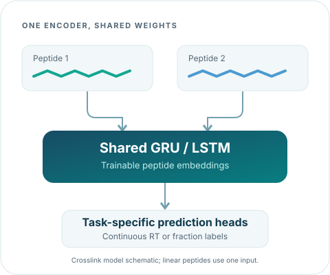
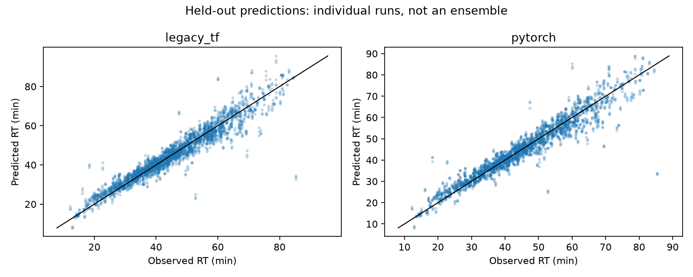

<div class="xirt-hero" markdown="1">
<div class="xirt-hero__copy" markdown="1">

{ .xirt-wordmark }

<p class="xirt-eyebrow">PEPTIDE SEQUENCES, CHROMATOGRAPHIC BEHAVIOR</p>

# Retention-time prediction<br>for peptide sequences.

Train PyTorch models for linear and crosslinked peptides. Predict continuous
retention times or fractions, adapt a saved model, and keep the preprocessing
and split information with every result.
{ .xirt-lead }

[Get started](getting-started.md){ .md-button .md-button--primary }
[Try a notebook](tutorials.md){ .md-button }

<p class="xirt-runtime">Python 3.12-3.14 &nbsp; / &nbsp; CPU or CUDA &nbsp; / &nbsp; Apache-2.0</p>

</div>
<div class="xirt-hero__visual" markdown="1">



</div>
</div>

## From input table to reusable model

<div class="grid cards xirt-cards" markdown="1">

-   **Train with your data**

    ---

    Choose continuous RT, categorical fractions or ordinal targets. Make input
    columns, modification encoding and scientific partitions explicit.

    [Configure a model](configuration.md)

-   **Adapt a checkpoint**

    ---

    Update the full recurrent model, train frozen-encoder heads, or add GRU
    LoKr or LoRA adapters. Reuse the base vocabulary and target transformations.

    [Explore fine-tuning](fine-tuning.md)

-   **Keep results traceable**

    ---

    Retain the model, encoder, effective configuration and split IDs together.
    Distinguish held-out predictions from training and validation rows.

    [Understand the outputs](results.md)

</div>

## Start with a working example

Install the **`xirt-torch`** distribution; import and run **`xirt`**.
Use Python 3.12-3.14 in an isolated environment.

=== "PyPI"

    ```bash
    pip install xirt-torch
    xirt --version
    xirt -p xirt_params.yaml -s learning_params.yaml
    ```

    Edit the generated configurations for your table's columns and targets.
    The [installation guide](getting-started.md) covers environments, optional
    dependencies and the full training command.

=== "Source checkout"

    ```bash
    git clone https://github.com/gieses/xiRT.git
    cd xiRT
    uv sync --locked --extra cpu
    uv run --no-sync xirt --version
    ```

    The `cpu` extra selects CPU-only PyTorch wheels. Use the mutually exclusive
    `cuda` extra on a compatible NVIDIA host.

=== "Notebooks"

    ```bash
    # From a source checkout:
    uv sync --locked --extra cpu
    uv run --no-sync marimo edit examples/train_predict.py
    # Or run both notebooks without a server:
    make examples
    ```

    The [CPU notebooks](tutorials.md) include 2,048 observed peptide pairs,
    checkpoint-based prediction, all four fine-tuning strategies and saved PNGs.
    Training uses validation-based early stopping.

## Python API: use xiRT in your own code

Use the bundled trained weights directly from Python: no training, configuration
files or model downloads are needed. This mock crosslink table needs only peptide
sequences and **one-based link positions**; observed labels and scores are absent.

```python
import pandas as pd

from xirt.predictor import Predictor

peptides = pd.DataFrame({
    "Peptide1": ["PEPTIDEK", "AKLVK"],
    "Peptide2": ["AAKPEPTIDER", "MPEPTIDEK"],
    "LinkPos1": [8, 2],
    "LinkPos2": [3, 9],
})

predictor = Predictor.load()  # Bundled joint RP/SCX/hSAX model; CPU by default.
predictions = predictor.predict(peptides)
print(predictions[["rp-prediction", "scx-prediction", "hsax-prediction"]])

explanation = predictor.explain(peptides.iloc[:1], task="rp", steps=256)
print(explanation.residues[["peptide", "position", "token", "attribution"]])
```

`predict` preserves row order and adds `rp-prediction` in **seconds**,
`scx-prediction` and `hsax-prediction` in continuous **fraction-index units**,
plus `unknown_token_count`. The explanation's signed contributions are also in
seconds here; positive values raise the output relative to the declared baseline.
These invented examples demonstrate the interface, not accuracy or causal chemistry.

Choose a separate model with `Predictor.load(model="rp")`, `"scx"` or `"hsax"`.
Use `Predictor.load(model="faims")` for the bundled charge/m/z FAIMS model and its
[precursor input schema](faims.md), or `Predictor.load("my_model.pt")` for custom
weights. `device="cuda:0"` requests CUDA when supported by your environment.

The same defaults work from the CLI:

```bash
xirt predict --input crosslinks.csv --output predictions.csv
xirt explain --input crosslinks.csv --output explanations --task rp --limit 1
```

These are source-study-specific models, not universal retention-time calibrators.
Read the [model cards](chromatography-models.md), the
[illustrated walkthrough](prediction-gallery.md), and the
[prediction/explanation API guide](explanations.md) for evaluation, units and limits.

<div class="xirt-evidence" markdown="1">
<div markdown="1">

## Compare the measured results

The framework comparison uses five modification-aware RP cohorts, shared
partitions and three initialization seeds. PyTorch has lower mean RMSE on two
cohorts; TensorFlow remains more accurate on three.

Full fine-tuning has the lowest mean RMSE on all five cohorts in the separate,
fixed four-strategy comparison. The cohorts are correlated views of two
studies, not independent external-transfer tests.

[TF versus PyTorch](benchmarks/tf-torch.md){ .md-button }
[Fine-tuning results](benchmarks/fine-tune-torch.md){ .md-button }

</div>
<figure markdown="1">

[](benchmarks/tf-torch.md)

<figcaption>Archived predictions, shared held-out pairs. See the protocol before comparing errors.</figcaption>

</figure>
</div>

## Find your next step

| Task | Read |
|---|---|
| Run your first model | [Installation and CLI](getting-started.md) |
| Follow a complete, runnable example | [Training and fine-tuning notebooks](tutorials.md) |
| Work directly in Python | [API reference](api.md) |
| Reuse a 1.x workflow | [Migration guide](migration.md) |
| Evaluate optional protein-language-model features | [ESM-C and adapters](embeddings.md) |
| Contribute or publish a release | [Development guide](development.md) |

!!! warning "A new backend, not an HDF5 converter"
    xiRT 2.0 uses native PyTorch checkpoints. TensorFlow/Keras `.h5` and `.hdf5`
    models cannot be loaded; keep legacy predictions for comparison and retrain
    for 2.0. Optional ESM-C features are experimental here and do not preserve
    the recurrent model's modification-aware input representation.

xiRT models peptide separation behavior; its predictions can be used in
downstream rescoring, but do not themselves establish identification confidence.
See the [citation and scientific references](references.md) for the original
crosslinking mass-spectrometry study.
