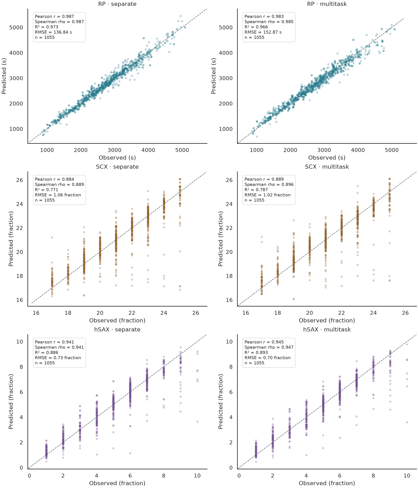
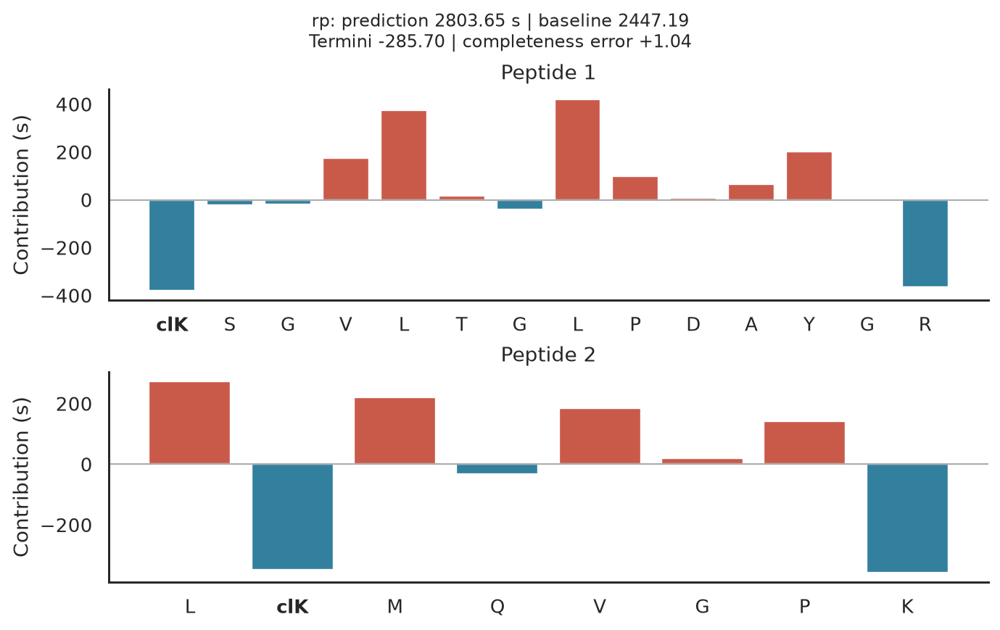
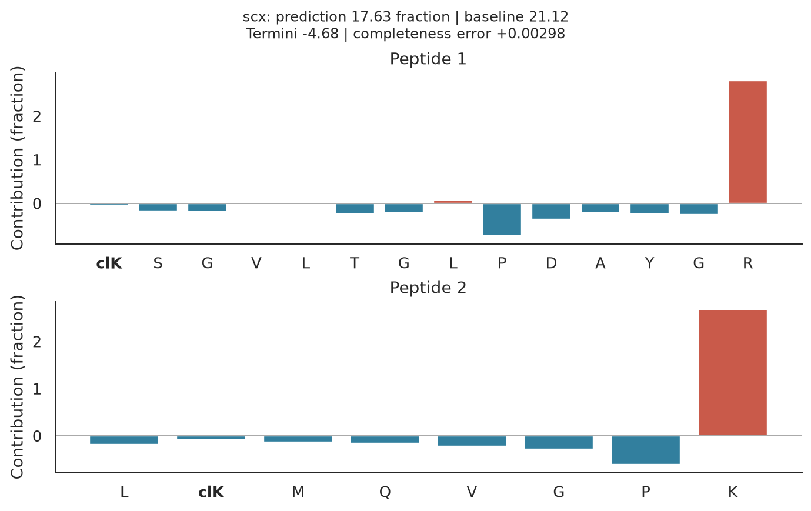
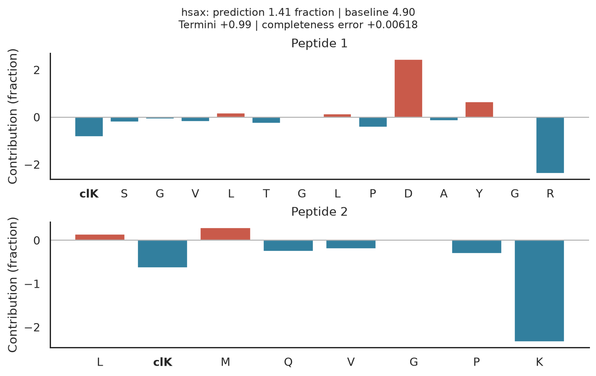
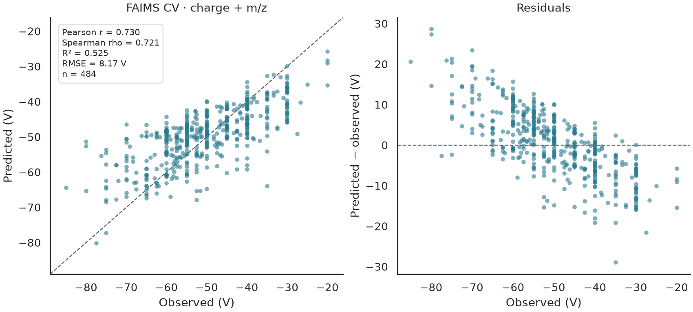
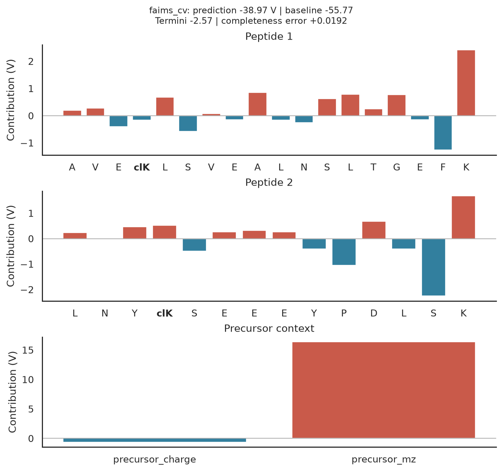

# Four predictions, one explanation workflow

What does a trained xiRT model predict, and which parts of a crosslink move that
prediction? This worked example uses **actual saved checkpoints** for reversed
phase (RP), strong cation exchange (SCX), hydrophilic strong anion exchange
(hSAX), and FAIMS. Nothing is fitted when this page is built.

!!! note "Read the units first"
    RP is in **seconds**. SCX and hSAX are **fraction-index regressions**, not
    elapsed times or class probabilities. FAIMS is mean observed compensation
    voltage in **volts**, not collision cross section or an intensity-calibrated
    optimal voltage.

## From the full dataset to a held-out prediction

Three separate models and one joint RP/SCX/hSAX model were trained on the full
eligible E. coli crosslink table from
[Zenodo 4720760](https://zenodo.org/records/4720760).
Of 17,059 CSMs, **11,072 target-target CSMs at FDR ≤ 1%** were eligible.
No eligible CSM was downsampled or removed for a duplicate peptide sequence.
Repeated observations therefore contribute repeated training examples.

The split groups unordered **unmodified peptide pairs**, keeping PTMs, link
sites and repeated CSMs together:

| Partition | CSMs | Unmodified peptide pairs |
| --- | ---: | ---: |
| Training | 8,924 | 4,558 |
| Validation | 1,093 | 570 |
| Test | 1,055 | 570 |

Vocabulary and target standardization use training rows only. Validation chooses
the saved weights; the test set is never used for early stopping. All four
models use the same split, sequence encoder and training budget. The joint
model has three heads, each with equal weight on **standardized MSE** so RP's
larger numerical scale does not dominate the fraction tasks.

This is within-study evaluation, not a new instrument, protein or peptide holdout.
Individual peptides can occur in different pairs across partitions. Earlier
analyses of this study's data were already available: these examples are
descriptive, not a newly blinded benchmark.

## Do the predictions track the observations?

The left column uses separate models; the right uses the joint model.
Each row shares axis limits. The dashed line is perfect agreement, not a fitted
regression line. Pearson r and Spearman rho measure association; RMSE and
predictive R-squared measure agreement.



For this split and seed, the separate RP model has lower RMSE (**136.84 s**
versus **152.87 s**). The joint model has slightly lower SCX RMSE (**1.018**
versus **1.055 fractions**) and hSAX RMSE (**0.703** versus **0.728 fractions**).
This is not evidence that multitask learning always helps: the models differ
in parameter count, and there are no repeated-seed uncertainty estimates.
The [model cards](chromatography-models.md#evaluation-and-limitations) list
the complete held-out metrics.

SCX and hSAX measurements occupy discrete fractions, hence the vertical bands.
Their predictions remain continuous; neither the plot nor the explanations
round or clamp them. These regressors do not provide calibrated class
probabilities or uncertainty intervals. Scores weight CSMs equally, so frequently
observed peptide pairs carry more weight than rare pairs.

## Follow the same crosslink through three heads

The examples below explain **one joint-model input**, changing only the selected
output head. The crosslink is the first held-out PSMID with both peptides between
8 and 22 residues. This rule uses IDs and peptide lengths, not prediction errors,
so the page does not pick a particularly successful prediction.

The selected crosslink is **PSMID 8847**: `KSGVLTGLPDAYGR` linked at residue 1
to `LKMQVGPK` at residue 2 (one-based positions).

| Output | Observed | Predicted | Baseline prediction |
| --- | ---: | ---: | ---: |
| RP, seconds | 2,762.93 | 2,803.65 | 2,447.19 |
| SCX, fraction index | 17 | 17.626 | 21.115 |
| hSAX, fraction index | 1 | 1.414 | 4.896 |

Positive bars raise the output relative to the baseline; negative bars lower
it. Red bars are positive; blue bars are negative. **Bold `clK` tokens mark
crosslinked lysines**. Modification annotations remain
part of their residue token. Both peptide branches contribute to the final
crosslink prediction; these are not independently measured peptide retention times.

=== "RP: seconds"

    

    Read the bars as signed changes in seconds, not a list of universal
    hydrophobicity constants. The model can use sequence context and interactions
    between residues; an identical residue need not receive the same attribution
    at another position or in another crosslink.

    Here, the leucines at positions 5 and 8 of peptide 1 raise the prediction,
    while its crosslinked lysine and final arginine lower it. Large positive and
    negative bars cancel: the total token contribution is **+355.41 s**, including
    **−285.70 s** from termini, not the sum of positive residue bars alone.

=== "SCX: fraction index"

    

    A positive contribution moves the prediction toward a higher SCX fraction
    number for this acquisition scheme. The model has no explicit charge-state
    input here. Do not interpret a bar as a measured charge contribution or
    assume the fraction numbering transfers to a different separation.

    The final arginine of peptide 1 and final lysine of peptide 2 have strong
    positive bars, whereas the crosslinked lysines have much smaller bars.
    Yet the overall contribution is **−3.492 fractions**, with **−4.678** from
    termini. Omitting termini would give the wrong explanation of why this
    prediction lies below its baseline.

=== "hSAX: fraction index"

    

    The same crosslink can show a different contribution pattern for hSAX than
    for SCX or RP. All three heads share the sequence encoder, but optimize
    different observed targets. A positive hSAX bar means a higher predicted
    fraction index, not an increase in RP time.

    The aspartate at position 10 of peptide 1 raises this output, while the
    terminal arginine and lysine lower it, opposite to their SCX signs.
    The total contribution is **−3.488 fractions**, even though termini
    contribute **+0.993**. These contrasts describe the heads' learned
    behavior for this one input, not universal residue rules.

## FAIMS separates sequence from precursor context

This uses the previously trained pooled 4PM/8PM **sequence + charge + m/z**
checkpoint, initialization seed 42. The 484 test precursors belong to held-out
unmodified peptide-pair groups. The target averages observed CV settings per
modified pair, sites, charge and source; it is not an abundance-weighted optimum.



On these 484 precursors, RMSE is **8.17 V**, MAE **6.41 V**, and predictive
R-squared **0.525**. The residual panel shows compression toward the middle:
the model tends to predict less-negative values at the most-negative observed
CVs and more-negative values at the least-negative end. Correlation alone
would not reveal that pattern.

The FAIMS example uses the same ID/length selection rule. In addition to residue
bars, the explanation has a precursor-context panel. Charge and m/z move jointly
from their fitted training means to this precursor's values along the integration
path. Their contributions are in **volts**, even though the input features have
different units.



This precursor is `AVEKLSVEALNSLTGEFK` linked to `LNYKSEEEYPDLSK` at residue 4
of each peptide, with charge **3** and m/z **1,263.111**. The observed mean CV
is **−31.00 V**, the prediction **−38.97 V**, and the baseline **−55.77 V**.
Along the declared path, m/z contributes **+16.36 V** and charge **−0.63 V**;
all tokens and context together contribute **+16.79 V**. A positive contribution
here means *less negative* CV, not a larger voltage magnitude.

The scalar attribution assigned to charge is not a controlled charge-state
experiment. Sequence and precursor features are correlated, and another baseline
or integration path can allocate their interactions differently.

## What the baseline and completeness check mean

These are embedding integrated gradients using the existing
[explanation API](explanations.md). Token IDs, sequence lengths and padding masks
are fixed; token embeddings move from zero to their learned values. FAIMS numeric
features move from their training means to their actual values on the same path.
The resulting baseline is **not an empty peptide or a chemically realizable
precursor**. Its prediction can depend on peptide lengths and model biases.

Terminus tokens are included in the attribution sum but listed separately
from residue bars. For every example:

```text
prediction = baseline prediction + all token/context contributions + completeness error
```

The gallery compares 128 with 256 integration points and, if necessary, increases
to 512. It requires absolute completeness error no larger than 0.05 output units
or 1% of the prediction–baseline difference, whichever is larger.
This is a numerical convergence check, not biological validation.
The [generated manifest](assets/prediction-gallery/manifest.json) records the
actual values, integration settings, checkpoint hashes and figure checksums.

All four examples passed at **256 points**. Their signed completeness errors
are **+1.037 s** (RP), **+0.00298 fractions** (SCX), **+0.00618 fractions** (hSAX)
and **+0.0192 V** (FAIMS). The 128-to-256-point maximum change in any token's
attribution was respectively 1.231 s, 0.00319 fractions, 0.00650 fractions and
0.0147 V. Small aggregate errors do not guarantee every individual bar is stable.

!!! warning "Explanations are not mechanisms"
    These are signed explanations of a fitted model, not causal residue effects.
    A small completeness error does not establish a correct chemical mechanism.
    Unknown PTMs, new fractionation protocols and acquisition shifts remain
    coverage and generalization limits.

## Reproduce without adding data to Git

The source table, split membership, row-level predictions and weights remain in
ignored local directories. This page commits only figures and aggregate/model
provenance. See the [model cards](chromatography-models.md) for the exact training
configuration, local checkpoint sizes and distribution status.

From a source checkout:

```bash
# Retrieve only the named table, not the multi-gigabyte supporting archive.
uv run --no-sync python -m xirt.data_pipelines.benchmarks.datasets.sources \
  --extract ecoli.zip ecoli/DSS_CSM_anpxirt.csv --cache local-data/zenodo-4720760

# Use a CUDA-enabled environment; CPU is also supported with --device cpu.
CUBLAS_WORKSPACE_CONFIG=:4096:8 uv run --no-sync python -m examples.train_chromatography \
  --device cuda:0

# Reuse the existing FAIMS benchmark checkpoint; this never trains or downloads.
uv run --no-sync python -m examples.generate_prediction_gallery
```

The training command verifies the pinned CSV's SHA-256 before fitting and saves
self-contained native checkpoints. To explain a different input:

```python
import pandas as pd

from xirt.predictor import Predictor
from xirt.qc import plot_residue_attributions

predictor = Predictor.load("local-data/chromatography-models/multitask/model.pt")
precursors = pd.DataFrame({
    "Peptide1": ["KSGVLTGLPDAYGR"],
    "Peptide2": ["LKMQVGPK"],
    "LinkPos1": [1],
    "LinkPos2": [2],
})
predictions = predictor.predict(precursors)
explanation = predictor.explain(precursors.iloc[:1], task="scx", steps=256)
figure = plot_residue_attributions(explanation)
```
